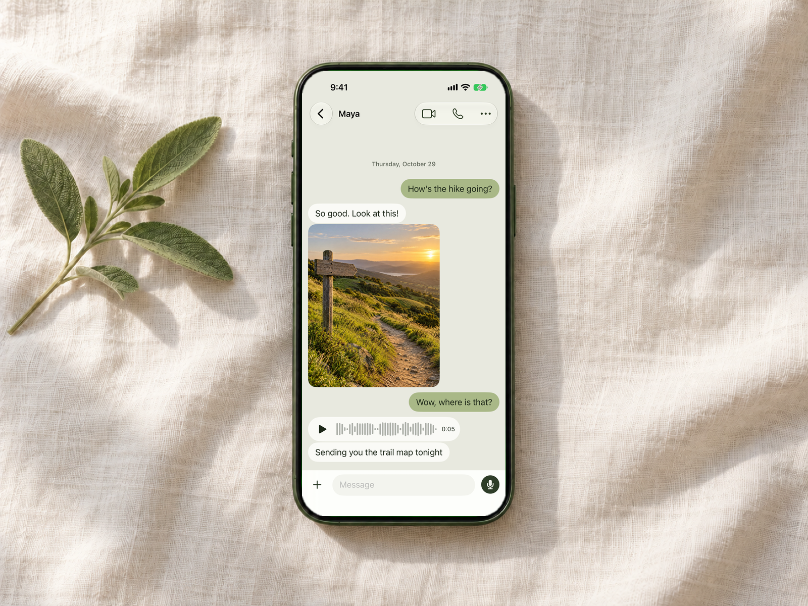
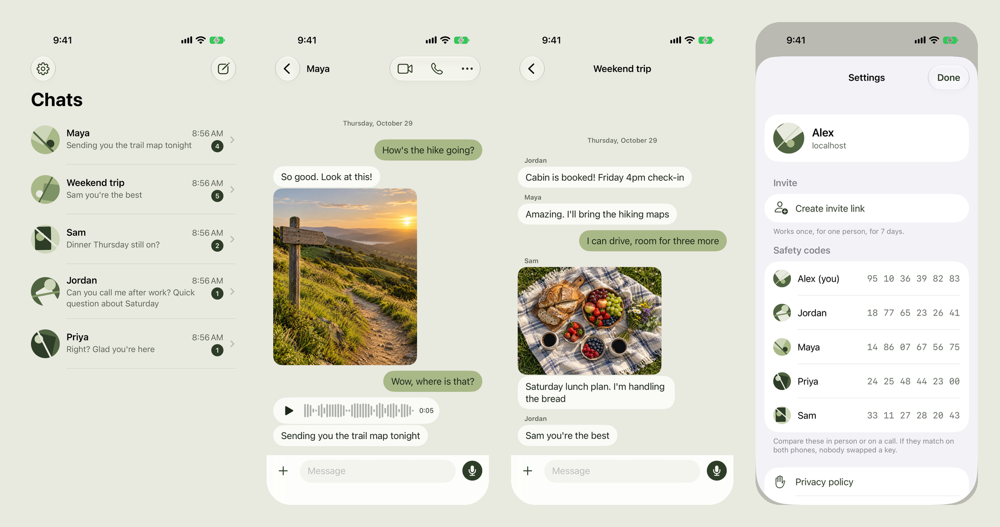

<p align="center"></p>

<h1 align="center">Talk</h1>

<p align="center">Private messages, voice notes and calls for a small circle of people, on a server you run.</p>

<p align="center">
  <a href="https://github.com/Princeu3/talk/actions/workflows/ci.yml"></a>
  <a href="LICENSE"></a>
</p>



Talk is a messenger for family, close friends or a small team. Messages, photos, files and voice notes are encrypted on your device before they leave it, so the server stores only ciphertext. Voice and video calls ring like phone calls and go straight between the two devices when the network allows.

There is a web app (works as an iPhone home-screen app too) and a native iPhone app with lock-screen calls. Both talk to the same server.



## What it does

- One-to-one chats and groups: text, photos, files, voice messages
- Voice and video calls between two people, through CallKit on iPhone (lock screen, Recents, Siri)
- End-to-end encryption: X25519 key agreement, AES-GCM, keys derived from your passphrase on your device
- Safety codes to check that nobody swapped a key
- Sign-up by invite link only; no phone number, no email
- Block, report a message or a person, delete your account
- Push notifications that carry only ids; the phone fetches and decrypts the message itself

## How it's built

| Part | Where | What |
| --- | --- | --- |
| Server | `server/` | Node 24, Express, Socket.IO, SQLite. Stores ciphertext, relays call signaling |
| Web app | `src/` | React and Tailwind. Installable PWA with web push |
| iPhone app | `ios/` | SwiftUI, CryptoKit, CallKit, PushKit, WebRTC. XcodeGen project |
| Push relay | `relay/` | Holds the APNs key, builds pushes from ids, serves the privacy, terms and support pages |

The server sees who talks to whom and when, and message sizes. It never sees content. Calls use WebRTC with DTLS-SRTP; when a network blocks direct connections, media passes through Cloudflare TURN, which only forwards encrypted packets.

## Run your own server

Talk runs on [Railway](https://railway.com) as one service with a volume.

1. Fork this repo, create a Railway project, add a service from your fork, and attach a volume at `/data`.
2. Set the variables below and add a domain (port 8080).
3. Open the deploy logs: while no account exists, they print a first-account link (`/?invite=<setup code>`). Open it to create your account.
4. In Talk, open Settings → Create invite link, and send one link per person. Each link works once and expires in 7 days.

| Variable | Purpose |
| --- | --- |
| `DATA_DIR` | Where the database and encrypted files live (`/data` on Railway) |
| `NODE_ENV` | `production` turns on secure cookies |
| `CF_TURN_KEY_ID`, `CF_TURN_API_TOKEN` | Cloudflare TURN key (Cloudflare dashboard → Realtime → TURN Server; the first 1,000 GB a month are free). Without it, calls use STUN only and fail on many cellular networks |
| `SETUP_CODE`, `SESSION_SECRET`, `VAPID_KEYS` | Optional; generated and stored in the database when unset |
| `PUSH_RELAY_URL` | Where iPhone app pushes go (default `https://push.princeuniverse.dev`); empty turns them off |

## Join a server

1. Open the invite link you were sent.
2. Pick a name and a passphrase. Four random words works well. Your passphrase is your key: nobody can reset it, and if you forget it your old messages are gone. Use the same name and passphrase on every device.
3. On iPhone, install the Talk app and paste the invite link into the first field. Or use the web app: open the link in Safari, tap Share → Add to Home Screen, and open Talk from the new icon (iPhone only sends web notifications to home-screen apps).
4. Compare safety codes in Settings, in person or on a call. If they match on both phones, nobody swapped a key.

## Development

Needs Node 24 or newer.

```bash
npm install
SETUP_CODE=local-setup npm run dev
```

Open http://localhost:5173/?invite=local-setup to create the first account.

```bash
npm run check   # typecheck
npm test        # end-to-end and relay tests
```

### iPhone app

Needs Xcode 26 or newer and [XcodeGen](https://github.com/yonaskolb/XcodeGen).

```bash
cd ios && xcodegen && open Talk.xcodeproj
```

Calls need a real iPhone: the Simulator ends every CallKit call. Everything else works in the Simulator. To use a local server, paste `http://localhost:3000/?invite=<code>` into the first field.

### Push relay

iPhone pushes need the app developer's APNs key, which self-hosted servers don't have. `relay/` holds it and sends to Apple. It builds every payload from ids, so it can't carry message text, and it stores nothing. Variables: `APNS_KEY` (the `.p8` contents), `APNS_KEY_ID`, `APNS_TEAM_ID`, `APNS_BUNDLE_ID`.

## CI and deploys

GitHub Actions runs the typecheck, web build, server and relay tests on Linux, and builds and tests the iPhone app on macOS, for every push and pull request. Railway deploys the push relay and the demo server from `master` on every push.

## Limits

- No forward secrecy: anyone who gets a passphrase can read that person's history.
- Removing someone from a group isn't supported.
- Voice messages recorded in older desktop Chrome (Opus) don't play on iPhone.

## License

[AGPL-3.0](LICENSE). If you run a modified Talk server for other people, share your changes.
